# Chess RPG: Training Grounds

**A dark-fantasy chess RPG where every piece is a hero, plus a self-improving AI team that trains armies and an adaptive rival that learns how to counter you.**

<p align="center">
  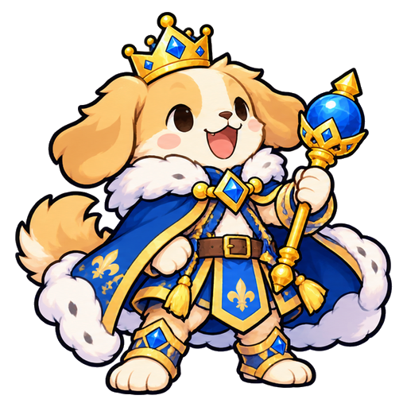
  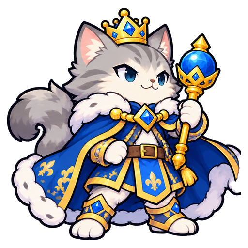
  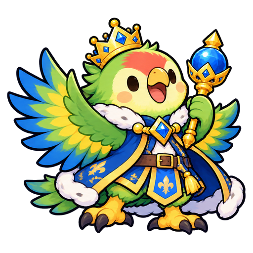
</p>
<p align="center"><sub>Choose your King: dog, cat, or parrot.</sub></p>

Started at c0mpiled-15 (Penn State, Oct 11, 2026) for Track 1A: Build a Self-Improving Agent Team (Luminal).

The repo contains two connected parts that share one engine, server, viewer, and MongoDB database:

1. **[Chess RPG](#part-1-chess-rpg):** the game. Chess movement, hero-card pieces, Fire Emblem-style combat, King-cast spells, deckbuilding, ladder, and online PvP.
2. **[Training Grounds](#part-2-training-grounds):** the AI training system. LLM coaches propose strategies, a deterministic engine tests them, and the best strategy survives each generation.

**Contents:** [Part 1: Chess RPG](#part-1-chess-rpg) · [Part 2: Training Grounds](#part-2-training-grounds) · [Architecture](#architecture) · [Run it](#run-it) · [Repo layout](#repo-layout) · [Team](#team)

---

## Part 1: Chess RPG

Chess has perfect rules but no personality. Fire Emblem has personality but less instant readability. Chess RPG keeps chess movement and replaces captures with combat: each piece is a hero card with HP, stats, a weapon, and a body type, so taking a square means winning a fight.

### Board
- 8x8 board with a river across the two middle rows, crossable on foot only at two bridges.
- Fliers cross anywhere, so bridge control is the central positional fight.

### Pieces are hero cards
Movement follows the chess role. Combat follows the hero in that slot.

<table>
<tr><th>Role</th><th>Heroes</th><th>Notes</th></tr>
<tr><td><b>Pawn</b></td><td><table><tr><td align="center">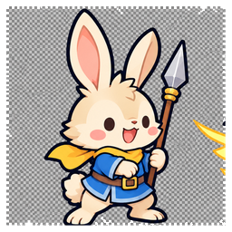<br><sub>Swordsman</sub></td><td align="center">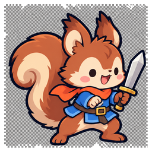<br><sub>Axeman</sub></td><td align="center">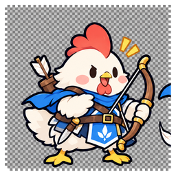<br><sub>Spearman</sub></td></tr></table></td><td>Weapon triangle decides pawn fights</td></tr>
<tr><td><b>Knight</b></td><td><table><tr><td align="center">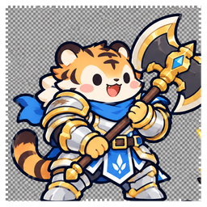<br><sub>Armored Knight</sub></td><td align="center">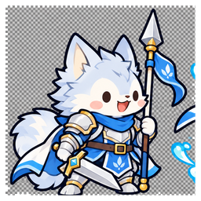<br><sub>Cavalier</sub></td><td align="center">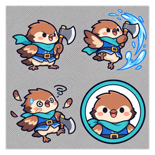<br><sub>Aero Knight</sub></td></tr></table></td><td>Jumping wall, fast double striker, or flier</td></tr>
<tr><td><b>Bishop</b></td><td><table><tr><td align="center">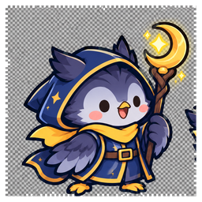<br><sub>Mage</sub></td><td align="center">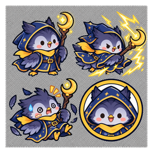<br><sub>Cleric</sub></td></tr></table></td><td>Magic along diagonals, or heals along them</td></tr>
<tr><td><b>Rook</b></td><td><table><tr><td align="center">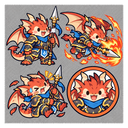<br><sub>Dragon</sub></td><td align="center">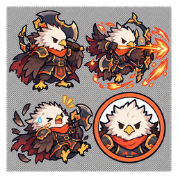<br><sub>Griffon</sub></td></tr></table></td><td>Flying heavy hitter or fast river crosser</td></tr>
<tr><td><b>Queen</b></td><td><table><tr><td align="center">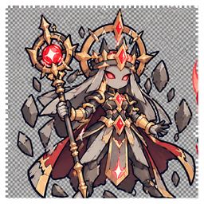<br><sub>Queen of Storms</sub></td></tr></table></td><td>3 instant kills, then gone. Promoted pawns become a new Queen</td></tr>
<tr><td><b>King</b></td><td><table><tr><td align="center">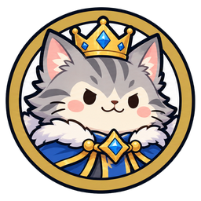<br><sub>King</sub></td></tr></table></td><td>Casts your spell cards. Lose him, lose the game</td></tr>
</table>

### Combat and spells
- Attacking starts an exchange: the attacker strikes and the defender may counter. A combat forecast shows damage dealt and taken before you commit.
- Weapon triangle: Sword > Axe > Lance > Sword. Tome magic targets resistance and deals double damage to armored units, half to fliers.
- The King casts up to 3 spell cards per battle, one use each, on a cooldown: Rally, Curse, Mend, Lightning, Fireball, Bulwark, Earthquake, Meteor, Resurrect.

<p align="center">
  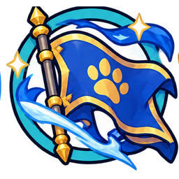
  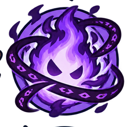
  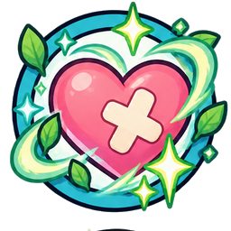
  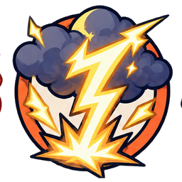
  
  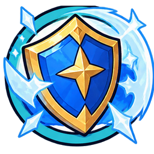
  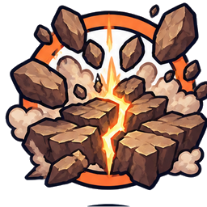
  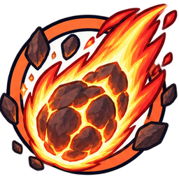
  
</p>

### Deckbuilding and progression
- Every hero and spell has a cost and a rarity (Common to Legend). A deck must fit a 16-point budget.
- Wins earn gems. Gems open rarity-weighted chests, unlock cards, and level them up to level 5.
- Player profiles, collections, decks, match history, and trophies persist in MongoDB. Accounts use scrypt-hashed passwords and expiring session tokens.

### Modes
- **Ladder:** 10 escalating AI opponents (Squire to Storm King), each with its own deck and personality (Rusher, Turtle, Tactician), plus a deck recommender per level.
- **Online PvP:** matchmaking queue with a ghost-opponent fallback (another player's saved deck, AI-controlled) when no live player is found.
- **Leaderboard:** trophies from PvP and ghost battles.

### Online PvP
- Clients join a queue (`POST /api/pvp/queue`), get paired into a room, and poll room state about once per second.
- Every move carries the room's sequence number. Stale moves are rejected with HTTP 409.
- The server checks every move against the rules engine's legal-move list for that turn before applying it, so the server, not the client, decides what happened.
- Leaving a game in progress counts as a forfeit. Results update both players' profiles and trophies.

### Known limitations
- PvP uses HTTP polling, not WebSockets.
- The sequence check and the room write are separate operations, and so are room matching and joining, so two simultaneous requests can race. Planned fix: conditional updates (filter on `seq` / `status` and check the modified count).
- Solo and ladder results are reported by the client.
- No automated test suite yet.

---

## Part 2: Training Grounds

Training Grounds is a Fire Emblem-style battle mode with chess-inspired units, terrain, elemental reactions, and army progression. Behind it, four parallel LLM coaches analyze battle results and evolve the army's strategy over generations.

### How it works
1. **Coach team (4 personas in parallel):** Aggressor, Warden, Terrain Tactician, and Analyst each read the last generation's battle summaries and propose a new *playbook*. A playbook is a structured strategy: formation, when to advance, target priorities, focus fire, terrain use, retreat threshold, and elemental tactics.
2. **Runner:** every candidate plays 60 deterministic battles (5 maps x 3 enemy personalities x 4 seeds). The best candidate by average score survives.
3. **Quartermaster:** spends experience and a 300-gold budget on levels, promotions, and items under a party cost cap.
4. **Memory in MongoDB:** every battle is stored with a compact summary (who died, to what, on which terrain, which reactions fired, when the HP lead flipped). Coaches query this history instead of reading raw logs.

Playbooks are validated field by field. Anything outside the allowed enums or ranges falls back to the parent playbook, so a bad LLM output cannot crash a run.

### Battle rules
- 8x8 grid, 4 player units vs 5 NPC units, max 10 turns. Win by routing the enemy, or by higher remaining HP ratio at turn 10.
- Terrain: plain, forest (evasion, burns under fire), fort (heals 10% max HP per turn), water (fliers only).
- Weapon triangle Sword > Axe > Lance > Sword (x1.2 / x0.8). Fire, Water, and Electric attributes with reactions.
- Classes promote at level caps 10/20/30 (Infantry to Armored, Cavalier, or Winged), each with a subskill.
- NPC personalities: Rusher, Turtle, Elementalist (training), and Hunter (held-out only).
- All randomness is seeded per battle: same inputs, same result.

### Proving the improvement is real
- **Frozen-stats control:** the same loop with growth disabled. If it still improves, the gain is strategy, not stat inflation.
- **Held-out test:** 2 maps and 1 enemy personality the agents never trained on.
- **Ablation:** LLM-guided search vs blind persona-biased mutation with the same candidate budget.

### Results

Score = win (1/0) + 0.5 x (own HP ratio - enemy HP ratio). Training set: n = 60 battles per row. Held-out set: n = 128 battles (2 unseen maps x 4 NPC personalities x 16 seeds).

| | Train win % | Train score | Held-out win % | Held-out score |
|---|---|---|---|---|
| Gen 0 baseline | 20.0 | 0.099 | 35.2 | 0.320 |
| Hand-written reference playbook | 47.0 | 0.440 | 54.7 | 0.568 |
| LLM coaches, gen 3 (best train) | 66.7 | 0.702 | 64.8 | 0.719 |
| LLM coaches, gen 8 (final) | 60.0 | 0.623 | 67.2 | 0.725 |
| Blind mutation, gen 8 (same budget) | 53.3 | 0.548 | 57.0 | 0.607 |
| Frozen stats: LLM coaches gen 4 / gen 8 | 58.3 / 58.3 | 0.608 / 0.592 | n/a | n/a |
| Frozen stats: blind mutation gen 8 | 53.3 | 0.548 | n/a | n/a |

- The baseline and hand-written rows are deterministic and reproducible from the engine alone.
- The LLM and mutation rows come from our hackathon runs (`agents/report.py`). Reproducing them requires MongoDB and the Luminal API, and LLM outputs vary between runs.
- With n = 60, one battle is about 1.7 points of win rate, so treat small gaps with caution.
- Running the 4 coaches concurrently took about 28 s per generation vs about 53 s sequentially (1.9x faster), and the best of the 4 candidates beat their average every generation.

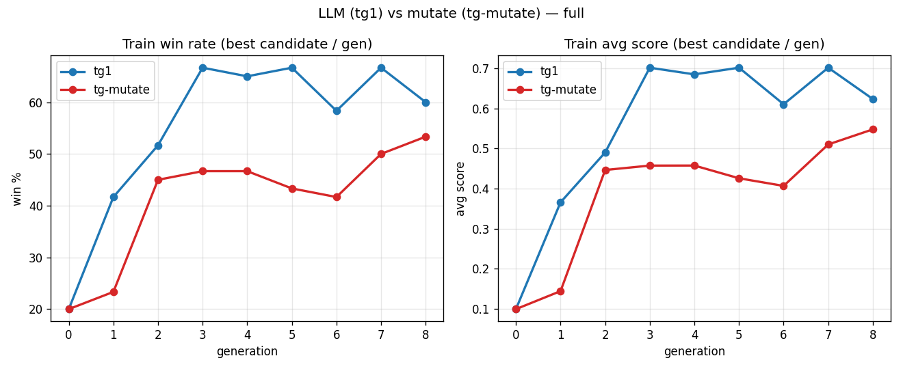
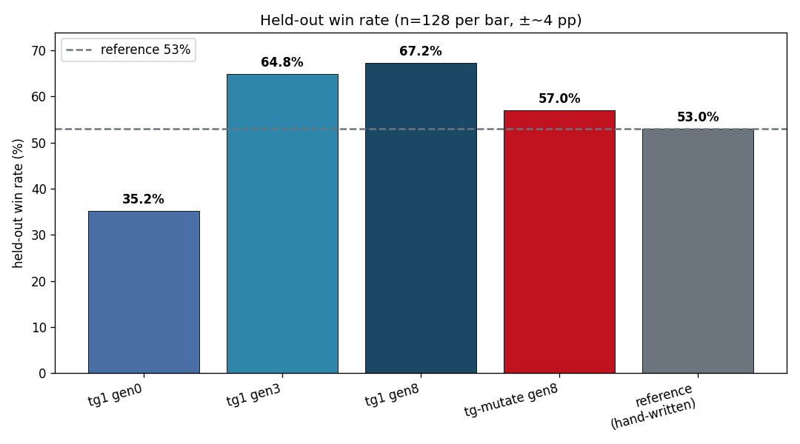
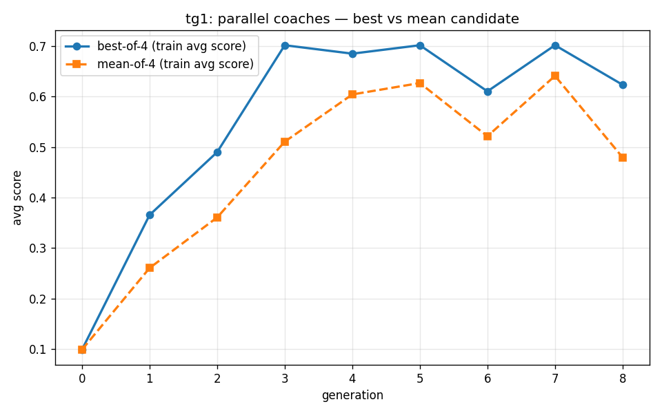
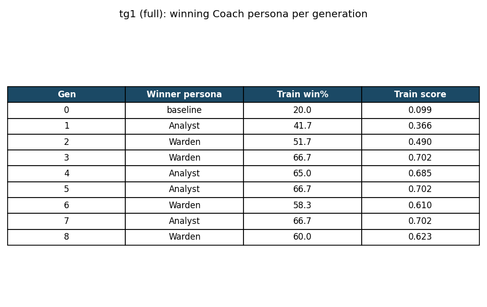
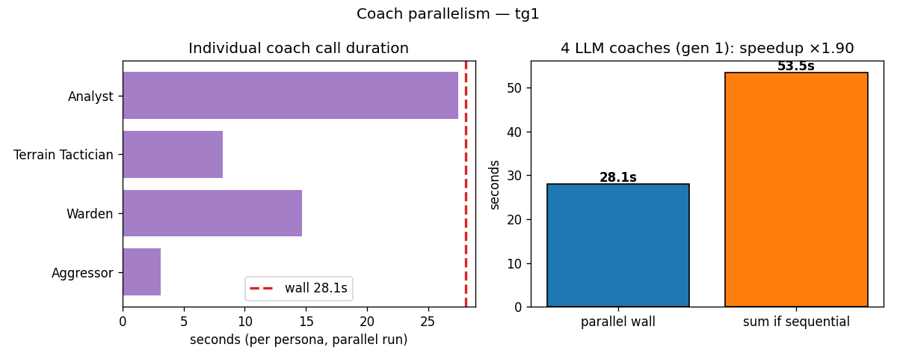

### Engine performance (measured)

Measured with `npm --prefix game run bench` (`game/scripts/bench.ts`): the 60-battle training set, 50 passes (3,000 battles), single thread, after warmup.

| Metric | Apple M1 Pro (laptop) | Intel Xeon 2.8 GHz (2-core cloud container) |
|---|---|---|
| Time per battle | mean 2.9 ms, median 2.9 ms, p95 3.9 ms | mean ~5.3 ms, median ~5.1 ms, p95 ~8.2 ms |
| Throughput | ~345 battles/s | ~185 battles/s |
| Full candidate evaluation (60 battles) | ~0.17 s | ~0.32 s |
| Determinism | 60/60 identical | 60/60 identical |

Both runs used Node 22 on a single thread. Determinism means the full event log of every battle hashed identically across runs. Absolute numbers vary by machine, so rerun the script to check yours.

### Solo mode with an adaptive rival
You can play Training Grounds yourself. Every battle you play is summarized and saved. The rival studies your habits (which unit carries you, whether you turtle on forts, hide in forests, or rush) and writes a counter-playbook for the enemy army. The more you play, the better it gets at beating you. The current rival is rule-based (`game/src/rival.ts`).

---

## Architecture

```
agents/ (Python)  --playbooks, parties-->  MongoDB Atlas  <--battles + summaries--  game/ (TypeScript)
  Coach x4 personas                          playbooks                               runner.ts
  Quartermaster                              parties                                 engine + rules
  loop.py (Luminal LLMs)  <--summaries---    generations      ---candidates-->       NPC personalities
                                             battles                                 playbook executor
                                             chess_players, chess_matches,           chess.ts (Chess RPG rules)
                                             chess_rooms, auth_users                 pvp.ts, auth.ts
                                               ^      |
                              solo battles     |      |  export --watch
                                               |      v
                     server.ts (API, adaptive rival, Chess RPG, PvP)  <-->  viewer/ (Vite + canvas)
```

- **game/:** deterministic battle engine (seeded RNG, ~5 ms per battle), NPC personalities, playbook executor with field-by-field validation and parent fallback, battle summarizer, MongoDB runner, export script, API server, rule-based rival, Chess RPG rules engine, ladder, card economy, accounts, and PvP.
- **agents/:** coach personas, Quartermaster, generation loop, reports. LLMs: DeepSeek / GLM Flash on Luminal Cloud via an OpenAI-compatible client.
- **viewer/:** dark fantasy UI. Chess RPG (home, deck builder, shop, ladder, PvP, leaderboard) and Training Grounds (win-rate curve, coach reasoning, playbook, Gen vs Gen replay on the same seed with a live in-browser re-run of all 60 training battles, Battle Prep, Battle replay, and Solo Battle with a combat forecast).

### How we use MongoDB
MongoDB is the shared memory and the contract between the TypeScript game and the Python agents. Neither side imports the other's code.

- `playbooks`: every strategy ever proposed, with persona, parent, and the coach's rationale (a full lineage of how the strategy evolved).
- `parties`: the army per generation (levels, promotions, items).
- `generations`: status handshake (pending, running, done, failed) plus per-candidate results.
- `battles`: every battle with its event log and a compact summary. Coaches query summaries (worst losses, failure patterns by map and enemy). Human solo battles live here too (`split: "human"`) and feed the adaptive rival.
- `chess_players`, `chess_matches`, `chess_rooms`, `auth_users`, `auth_sessions`: Chess RPG profiles, match history, PvP rooms, and accounts.

The viewer stays live via `export --watch`, which re-exports a run whenever a generation finishes. See `shared/PLAN.md` for the full schema and handshake.

---

## Run it

Requirements: Node 20+, Python 3.11+, a MongoDB URI in `.env` (see `.env.example`), and Luminal API credentials for the coaches.

```
# install
cd game && npm install && cd ../viewer && npm install && cd ..

# engine checks (no database needed)
npx --prefix game tsx game/src/executor.ts     # baseline vs hand-written playbook
npm --prefix game run bench                    # engine benchmark

# Chess RPG + Training Grounds viewer
npm --prefix game run runner -- --dry
npm --prefix game run runner -- --init --run myrun --condition full
npx concurrently "npm --prefix game run server" "npm --prefix viewer run dev" "npm --prefix game run export -- --run myrun --watch"
# open http://localhost:5173/?run=myrun

# agents (see agents/README)
cd agents && python -m venv .venv && source .venv/bin/activate && pip install -r requirements.txt
python loop.py --run-id myrun --no-seed-gen0 --generations 8 --coach llm
```

## Repo layout

```
game/     engine, rules, maps, NPCs, executor, runner, summary, export, API server, rival,
          Chess RPG rules, ladder, cards, accounts, PvP, scripts/bench.ts
agents/   coach, Quartermaster, generation loop, reports (Python)
viewer/   game-style web UI (Vite + TypeScript + canvas)
shared/   PLAN.md (the shared contract between game and agents), result charts
```

## Design credit

Game rules, classes, attributes, terrain, and UI flow are adapted from Yoojun's own SRPG design docs (the "Purifier" project): weapon triangle, magic effectiveness by class, attribute marks and elemental reactions, fort healing, forest evasion and burning, and the Battle Prep and battle screen layouts. Story, nations, the boss action phase, and 5 of the 8 attributes were cut for the hackathon.

## Team

- **Yoojun Kim:** project creator, game director, and technical lead. Concept, architecture, game systems design, and technical direction across both parts. Implemented the battle engine, rules, NPC personalities, playbook executor, runner, summarizer, MongoDB integration, Chess RPG rules engine, ladder, card economy, accounts, API server, viewer, solo mode, and the adaptive rival.
- **Jonghun Won:** implemented the Python agent team (coach personas, Quartermaster), generation loop, experiments, and reports, and the PvP server (`game/src/pvp.ts`) to the project's specification.
